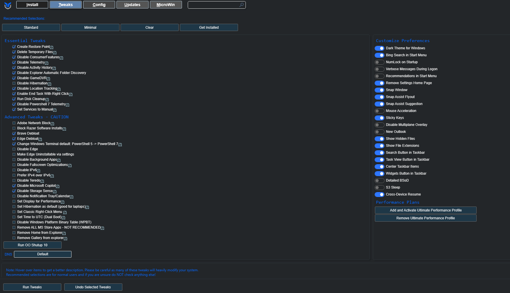

# Windows 11 Development Setup 2026. Hybrid Windows with WSL Linux
Welcome to my dotfiles for a recent Windows installation focused on being my daily driver. In my case, I use it for gaming and work, so I have apps that benefit me in this regard. 

I chose this environment because of the number of problems I was having with Linux lately. Don't get me wrong, I love Linux, but I don't have enough time to spend fixing things every day, Whether it's game incompatibility or poorly executed updates. So I preferred to maintain some peace of mind at the expense of the modularity that Linux offered me.

That's why I chose a hybrid environment thanks to WSL.

NOTE: I will also leave all configurations as dotfiles so that they remain as examples.

# Basic Setup
## 1 - Installing Software on Fresh install
* Before starting installing software, be sure that you update the system, remove trash apps and software. Clean the system, change privacy settings and customize the theme.

* In windows settings, add Openssh server component. And in developer settings, enable End Task at righ click, enable sudo and development options.
* We format and organize the secondary hard drives. In my case, I have a 2 TB HDD where I will leave 300 GB to create my DevDrive, which is a new feature of Windows 11 that creates an ReFS partition optimized for development.

* Install the main drivers via your software center provided by the motherboard, in my case Gigabyte. Peripherals such as my JBL headphones and graphics software. In my case, I use the new Nvidia app to update the graphics drivers. Unfortunately, we cannot install it with Winget, so we will have to install it manually: https://www.nvidia.com/es-es/software/nvidia-app/

* Now install my daily driver software:
  ```
     winget install Piriform.CCleaner; winget install Spotify.Spotify --force; winget install VideoLAN.VLC; winget install Microsoft.VCRedist.2015+.x86; winget install Microsoft.VCRedist.2015+.x64; winget install Microsoft.VCRedist.2013.x86; winget install Microsoft.VCRedist.2013.x64; winget install Microsoft.VCRedist.2012.x86; winget install Microsoft.VCRedist.2012.x64; winget install Microsoft.DotNet.SDK.8; winget install Microsoft.DotNet.DesktopRuntime.8; winget install Microsoft.DotNet.AspNetCore.8; winget install Microsoft.DotNet.Runtime.8; winget install Microsoft.DotNet.Runtime.6; winget install Microsoft.DotNet.Runtime.5; winget install Microsoft.DotNet.Runtime.3_1; winget install 7zip --source winget; winget install Valve.Steam --source winget; winget install Discord.Discord --source winget; winget install NZXT.CAM; winget install Logitech.GHUB; winget install Brave.Brave; winget install Bitwarden.Bitwarden; winget install Mozilla.Thunderbird; winget install splode.pomotroid; winget install Guru3D.Afterburner; winget install Microsoft.PowerToys;
  ```
  
* Apps that I use from Microsoft Store: Ambiance
___

## 2 - Configure Software
* Clean the system with ccleaner.
* Now starting adding accounts to the main web browser (Brave in my case).
* Config Nvidia panel to your best performance settings and MSI Afterburner with undervolt settings.
* When you finish all, we could use a tool created from Chris Titus: https://github.com/ChrisTitusTech/winutil. Only execute the command indicated in your repository as Admin:
  ```
    irm "https://christitus.com/win" | iex 
  ```
  Select this Options and click on RUN TWEAKS:
  

* After this you will have a clean Windows 11 installation :3
___

# Development Setup
## 1 - Development setup

* First of all, we should able wsl. Open a terminal on admin mode and launch this command:
  ```
    wsl --install
  ```
  Restart and continue.

* For install a wsl distribution, use this command:
  ```
    wsl --install -d Ubuntu
  ```

* Configure WSL to your liking using the new interface they have incorporated for this purpose. Simply search for wsl on the home page and you should see the app.

* Install the development software that I use.
  ```
    winget install Microsoft.VisualStudioCode; winget install Git.Git; winget install GitHub.GitLFS; winget install Microsoft.GitCredentialManagerCore; winget install Amazon.AWSCLI; winget install JetBrains.Toolbox; winget install Obsidian.Obsidian; winget install Docker.DockerDesktop;
  ```
* Disable AWS telemetry: setx AWS_CLI_TELEMETRY_DISABLED 1

* We are also going to install our own program manager for users, which, combined with winget, will give us access to much more software. People prefer Chocolatey, but in my case, I prefer Scoop because it is less intrusive. First of all, we will run this command in a terminal in administrator mode.
  ```
    Invoke-RestMethod -Uri https://get.scoop.sh | Invoke-Expression
  ```

* Once executed and permissions granted for scoop, we proceed to install it with the following command:
  ```
    Invoke-RestMethod -Uri https://get.scoop.sh | Invoke-Expression
  ```

* Now we are going to install some programs necessary for my dotfiles with scoop. We will run the following commands:
  ```
    scoop install neovim
    scoop install uv
    scoop install fzf
  ```
  Neovim is for having another text editor in the terminal, fzf is for complementing the terminal, and uv is the Python manager we will use for both Python versions and virtual environments. For more information, consult their documentation: https://docs.astral.sh/uv/getting-started/

___
## 2 - Config ssh key for git porpouses and commit sign
Now we are going to configure an SSH key for authentication and signing commits. You must have installed OpenSSH Server in the additional components. The process I am going to use involves verifying the identity of the commits I make. The service I use for version control is GitHub, but I imagine it would be more or less the same for other providers. I should also point out that I use the noreply service provided by GitHub, so the email address I configure is the one spec

* Launch a terminal in admin mode and execute:
  ```
    Get-Service -Name sshd | Set-Service -StartupType Automatic
    Start-Service sshd
  ```

* Then we open another terminal as usual and execute the following command, press Enter, and enter a password:
  ```
    ssh-keygen -t ed25519 -C "your_email@example.com"
  ```

* In the terminal that we had open as administrator, we executed these commands::
  ```
    Get-Service ssh-agent | Set-Service -StartupType Manual
    Start-Service ssh-agent
    Get-Service ssh-agent
  ```

* Add your new key to SSH Agent:
  ```
    ssh-add ~\.ssh\id_ed25519
  ```

* Run cat to show our Public key, and add it to your github account as Authentication and Sign key.
  ```
    cat ~/.ssh/id_ed25519.pub
  ```

* To verify that we have incorporated it correctly, we run an ssh to GitHub.
  ```
    ssh -T git@github.com
  ```
* Now we are going to create a configuration file for ssh that saves the credentials and avoids getting too involved with passwords. First create file in .ssh and name it as **config** and paste this code into this file:
  ```
    Host *
      IdentityFile ~/.ssh/id_ed25519
      AddKeysToAgent yes
      IdentitiesOnly yes
  ```
* Now that we have the entire environment ready, we can proceed to configure .gitconfig. If you haven't created it yet, run this command (git config --global core.sshCommand C:/Windows/System32/OpenSSH/ssh.exe) to create it automatically, then open it with your favorite editor and paste the following code:
  ```
    [core]
        editor = code --wait
        sshCommand = C:/Windows/System32/OpenSSH/ssh.exe

    [user]
      name = username
      email = email
      signingkey = C:/Users/YOURWINDOWSUSERNAME/.ssh/id_ed25519.pub

    [init]
      defaultBranch = main

    [url "git@github.com:"]
      insteadOf = https://github.com/
  
    [gpg]
      format = ssh
  
    [commit]
      gpgsign = true

    [diff]
        tool = vscode

    [difftool "vscode"]
        cmd = code --wait --diff $LOCAL $REMOTE

    [merge]
        tool = vscode

    [mergetool "vscode"]
        cmd = code --wait $MERGED

    [filter "lfs"]
        clean = git-lfs clean -- %f
        smudge = git-lfs smudge -- %f
        process = git-lfs filter-process
        required = true
  ```
  This configuration will prepare Git to sign with your verified Git key, as well as set VSCode as the default editor, diff tool, and merge tool.

* For deploy your ssh key go to github, and add the public key into ssh and gpg management. If you did it right, run: ssh -T git@github.com

___
## 3 - Dotfiles
In this repository, you will find several configuration files that will be needed. They are all located in the dotfiles folder, which will be taken as your user's home folder, so the file structure will be the same. Copy this files or create it in your home folder.

Currently, I am using Oh My Posh on the Windows PowerShell terminal, but I am considering using Starship to visually unify the WSL and PowerShell consoles. For now, for this first corrected version, I will leave it as it is and try to remove Oh My Posh and replace it with Starship, which is also written in Rust!
___

## 4 - Terminal configuration
* Now we're going to choose the fonts we want from nerd fonts. In my case, I usually download seven or so, and for the terminal I use Hack Nerd Fonts. You can find the font releases at this link: https://github.com/ryanoasis/nerd-fonts/releases

* I like to have a semi-transparent terminal background, so I have to enable acrylic in the customization settings. Otherwise, Windows ignores this setting and makes everything opaque.

* In the terminal settings, select PowerShell as the default. Close the terminal and reopen it.

* Now, under the settings/windows_terminal_config folder, you will find the settings.json file, which contains all the visual settings, shortcuts, and other information. All you have to do is open the Windows terminal, open the json file, and copy and paste the contents of the repository into it. Be careful, as this may change your terminal's GUID. In other words, it may change the ID of each type of terminal, so be careful when copying.

* With the fonts installed, you will need to change depending on which one you want to use in the JSON.

* We install oh my posh with the following command.
  ```
    winget install JanDeDobbeleer.OhMyPosh -s winget
  ```

* Now we install the necessary modules for the PowerShell configuration in order.
  ```
    Install-Module posh-git -Scope CurrentUser -Force
    Install-Module -Name Terminal-Icons -Repository PSGallery -Force
    Install-Module -Name z -Force
    Install-Module -Name PSReadLine -Scope CurrentUser -Force -SkipPublisherCheck
    Install-Module -Name PSFzf -Scope CurrentUser -Force
  ```

* Edit our terminal profile using a command. I use neovim, but you can replace it with code if you want it to be more visual.
  ```
    nvim $PROFILE.CurrentUserCurrentHost
  ```

* And we paste the following block of code that launches the PowerShell configuration.
  ```
    . $env:USERPROFILE\.config\powershell\user_profile.ps1
    $env:VIRTUAL_ENV_DISABLE_PROMPT = 1
  ```

* To avoid breaking anything when starting the PowerShell terminal, you should have the contents of the dotfiles folder pasted into your home directory.

___
## 5 - Visual Studio Code Setup
* To get my vscode configuration, we will first install all my extensions. The command to install it is:
  ```
    code --install-extension extension_name
  ```

* All extensions are as follows:
  ```
    aaron-bond.better-comments
    alefragnani.project-manager
    batisteo.vscode-django
    cweijan.dbclient-jdbc
    cweijan.vscode-mysql-client2
    esbenp.prettier-vscode
    formulahendry.auto-close-tag
    formulahendry.auto-rename-tag
    github.remotehub
    graphql.vscode-graphql
    graphql.vscode-graphql-syntax
    gruntfuggly.todo-tree
    hbenl.vscode-test-explorer
    ibm.output-colorizer
    idleberg.icon-fonts
    kamikillerto.vscode-colorize
    kevinrose.vsc-python-indent
    littlefoxteam.vscode-python-test-adapter
    mhutchie.git-graph
    miguelsolorio.fluent-icons
    miguelsolorio.symbols
    mikestead.dotenv
    mkxml.vscode-filesize
    mrmlnc.vscode-autoprefixer
    ms-azuretools.vscode-containers
    ms-azuretools.vscode-docker
    ms-kubernetes-tools.vscode-kubernetes-tools
    ms-python.debugpy
    ms-python.isort
    ms-python.python
    ms-python.vscode-pylance
    ms-python.vscode-python-envs
    ms-vscode-remote.remote-containers
    ms-vscode-remote.remote-ssh
    ms-vscode-remote.remote-ssh-edit
    ms-vscode-remote.remote-wsl
    ms-vscode-remote.vscode-remote-extensionpack
    ms-vscode.azure-repos
    ms-vscode.remote-explorer
    ms-vscode.remote-repositories
    ms-vscode.remote-server
    ms-vscode.test-adapter-converter
    njpwerner.autodocstring
    pranaygp.vscode-css-peek
    redhat.vscode-yaml
    spywhere.guides
    wholroyd.jinja
    yzhang.markdown-all-in-one
    zhuangtongfa.material-theme
  ```

* Finally, to configure it, I will leave the settings.json file in settings/vscode_settings. Just copy and paste the content into your settings.json file, and that's it! VSCode is now ready to use!.
___

# Other Tweaks
## 1 - Ollama installation and models.
* I like to run my own models locally, so I use Ollama, which allows me to install models such as Llama3, Nemotron, or Deepseek. On Windows and Mac, they have created a ChatGPT-style interface that allows you to talk to the different models.

* Ollama installation url: https://ollama.com/download

* Restart terminal and run: ollama run llama3, this will pull the llama3 AI model and starts. Now exec /bye for exit the model.

## 2 - Python version manager and lib manager

* We have already installed UV with scoop, this Python manager is practically an all-in-one solution. You can install any version of Python, create virtual environments, install packages while blocking dependencies, etc. It is very comprehensive and highly recommended. I am including the documentation again so you have it handy. https://docs.astral.sh/uv/guides/install-python/
  
## 3 - WSL Ubuntu Setup

* When you installed the WSL distribution, you had to create a username and password. Now it's time to set up the environment properly. To do this, we will start the Ubuntu console and run the following commands:
  ```
    sudo apt update && sudo apt upgrade
    sudo apt install -y build-essential make curl ca-certificates postgresql-client-16 libssl-dev libxmlsec1-dev libmagic-dev libmagickwand-dev zsh fzf git-lfs
    chsh -s $(which zsh)
    sh -c "$(wget -O- https://raw.githubusercontent.com/ohmyzsh/ohmyzsh/master/tools/install.sh)"
  ```

* Close the Ubuntu console and restart WSL with wsl --shutdown. Reopen it and run the following commands to install the plugins.
  ```
    git clone https://github.com/zsh-users/zsh-syntax-highlighting.git ${ZSH_CUSTOM:-~/.oh-my-zsh/custom}/plugins/zsh-syntax-highlighting
    git clone https://github.com/zsh-users/zsh-autosuggestions ${ZSH_CUSTOM:-~/.oh-my-zsh/custom}/plugins/zsh-autosuggestions
    git clone https://github.com/MichaelAquilina/zsh-you-should-use.git ${ZSH_CUSTOM:-~/.oh-my-zsh/custom}/plugins/you-should-use
    git clone https://github.com/Aloxaf/fzf-tab ${ZSH_CUSTOM:-~/.oh-my-zsh/custom}/plugins/fzf-tab
    sudo apt autoremove -y
    sudo apt autoclean
    curl -sS https://starship.rs/install.sh | sh
  ```

* Now execute this command to create the .gitconfig file:
  ```
    git config --global user.name "username"
  ```

* Once the command has been executed and the file created, in the Ubuntu terminal we create the SSH key as in Windows:
  ```
    ssh-keygen -t ed25519 -C "youremail"
  ```

* We execute the following commands in order to add the ssh key to the agent:
  ```
    eval "$(ssh-agent -s)"
    ssh-add .ssh/id_ed25519
    cat .ssh/id_ed25519.pub
  ```

* Copy the public key and add it as we did in GitHub to have access via SSH and signature. Basically, you must follow the same steps we did for PowerShell.

* We run the following commands to get the WSL machine ready.
  ```
    sudo mv /etc/apt/apt.conf.d/20apt-esm-hook.conf /etc/apt/apt.conf.d/20apt-esm-hook.bak
    sudo apt install -y unzip curl
    curl -LsSf https://astral.sh/uv/install.sh | sh
    source $HOME/.local/bin/env
    curl "https://awscli.amazonaws.com/awscli-exe-linux-x86_64.zip" -o "awscliv2.zip"
    unzip awscliv2.zip
    sudo ./aws/install
    rm -rf aws
    rm -rf awscliv2.zip
  ```
* We run (explorer.exe .) And finally, to finish configuring WSL, we copy the contents of the dotfiles_wsl folder into the open window and review the configuration to change the placeholders for these settings.

*  **With that, we have completed a fresh installation of Windows 11! Restart the terminal and you will have everything ready.**
